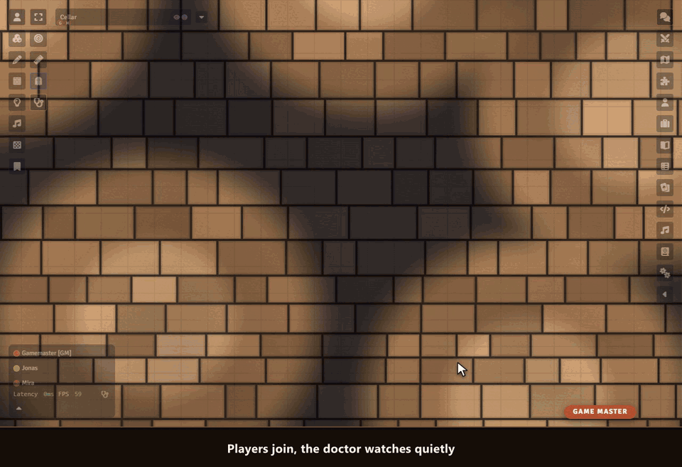

# Sephral’s Performance Doctor

**Five frames per second on a strong computer? A map that never finishes loading for one player? Performance Doctor finds out why Foundry is slow, explains it in plain words and fixes it with you, step by step.**

## Highlights

* **Knows the usual suspects:** a browser that draws without the graphics card, a scaled screen, quality set too high, a laptop on battery, the browser's energy saver. It names the cause and shows the way out for your browser.
* **Make my game faster:** ten seconds of measuring, the settings that help most with one click, a second measurement that shows the difference. Everything can be undone.
* **Graphics test:** switches lighting, animations, weather, videos and module effects off for a moment each and shows what costs the most on your computer.
* **Which module eats the time:** measures every module, the system and Foundry for 15 seconds, and the next start of Foundry too.
* **Heavy scenes:** the GM sees how many megabytes a scene sends to every player and how long the slowest player waits. A huge map becomes a small WebP copy with one click, and the original stays.
* **The whole table at a glance:** frame rate, delay, download speed and graphics chip of every player, a warning when someone still waits for a scene, and a button that asks a player to check.
* **The world:** what every player downloads when joining, the largest documents, images hidden inside journals, an oversized chat log.

## How it works

1. Enable the module.
2. Click the stethoscope in the token controls or next to the frame rate in the players list.
3. Follow the hints. Players fix their own computer, the GM gets what only the GM can change.

## Good to know

The doctor watches quietly and costs no noticeable time. When a game stays very slow, it offers its help on its own, once per session.

## Install

Use the manifest URL `https://github.com/Sephral/sephrals-performance-doctor/releases/latest/download/module.json` in Foundry's module installer.

Foundry VTT 13 and 14 · any game system · English and German

## Learn more

What the doctor measures, how it finds the causes and every setting are explained in the [manual](MANUAL.md). Questions or ideas? Join us on [Discord](https://discord.gg/7BjCgDYaBP). Looking for more? See [all modules by Sephral](https://github.com/Sephral).

## License

See [LICENSE.md](LICENSE.md).
